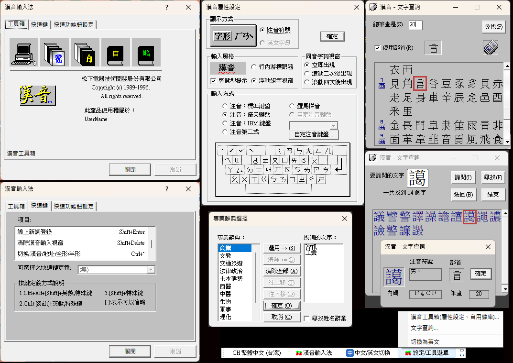

# 漢音輸入法復原版(Hanin Revival)

讓 Windows 95 時代的 **Panasonic 漢音輸入法 5.02**,在 64 位元的 Windows 10 / 11 上重新使用。



原版漢音是 1997 年的 32 位元 IMM32 輸入法,在現代 Windows 上無法載入 64 位元程式(瀏覽器、Office、檔案總管…),
而且會做一些在新系統上很危險的事(模擬全系統按鍵、搬動滑鼠游標)。本專案**不修改、也不散佈**原版漢音,
而是寫了一層橋接程式,把原版的轉換引擎放在獨立的行程裡安全地執行:

```
各應用程式(64/32 位元)
   └─ HaninTip64/32.dll   TSF 前端:收鍵、行內組字、選字窗、語言列
         │ 具名管道
         ▼
   hanin_host.exe(32 位元)  載入原版 HANIN95.IME,自行提供 IMM32 服務,
                             攔截危險 API;引擎當掉或卡住會自動重啟
```

打字手感、長句自動選字、同音字窗(A–E 列、1–6 選字)都是原版引擎本身的行為。

## 安裝

1. 自行取得 **漢音 5.02 試用版** 的安裝檔 `Hanin502.exe`(早年各大學 FTP 站都有收錄)。
   本專案**不提供**這個檔案。
2. 下載 [Releases](../../releases) 裡的 `HaninRevival-Setup-x.y.z.exe`,和 `Hanin502.exe` 放在**同一個資料夾**。
3. 執行安裝程式。它會先驗證 `Hanin502.exe` 的 SHA-256,確認是未被修改過的原版:

   ```
   C8EE45C4F0C24DE502912DD1747A66481AD7CFB6A953540B814205458C9B5814   (2,560,780 bytes)
   ```

   不符就會停止安裝(例如下載到夾帶病毒的檔案)。驗證通過後才解出引擎、字典與工具箱,並註冊為系統輸入法。
4. **登出再登入 Windows**,讓所有程式載入漢音。之後按 `Win + 空白鍵` 選「漢音輸入法」。

需求:Windows 10 1903 以上或 Windows 11,64 位元。

## 使用

- **設定(標準 / 倚天 / IBM 鍵盤等)**:浮動語言列的「設定/工具選單」→「漢音工具箱」,
  或開始功能表的「漢音工具箱」。這就是原版的工具箱。
- **中 / 英切換**:單按 Shift,或點語言列的「中文/英文切換」。
- 可用的原版快速鍵:`Ctrl+3` 特殊符號表、`Ctrl+/` 曖昧音字集、`Ctrl+4` 重複句庫、
  `Ctrl+2` 文字查詢、`Ctrl+6` 工具箱、`` Ctrl+` `` 切換漢音/地址/全形/半形。
  只有在使用漢音時才有作用;快速鍵可在工具箱的「快速鍵」頁修改。

個人設定與自用辭庫存在 `%LOCALAPPDATA%\HaninRevival\data`,解除安裝時會保留。

## 已知限制

- **有反作弊系統的遊戲(例如 VRChat 的 Easy Anti-Cheat)無法使用**:反作弊只接受有正式程式碼簽章的 DLL,
  目前的版本沒有簽章。
- 原版的浮動視窗(快速功能鈕 `Ctrl+1`、螢幕鍵盤 `Ctrl+5`)與線上說明(WinHelp `.hlp`)尚未支援;
  對應的快速鍵會直接交還給應用程式。
- 工具箱「輸入風格」的「行內游標跟隨 / 浮動組字視窗」**沒有作用,一律是行內組字**(字直接顯示在游標處、加虛線底線)。
  原版的組字窗是引擎自己畫的視窗,但在本專案中,引擎在背景的獨立行程裡執行,它的視窗全部設為隱形,
  也不能搶焦點或攔截滑鼠。組字內容改由 TSF 前端直接寫進應用程式,這也是 Windows 內建輸入法的做法。
  若要重現浮動組字窗,得另外在游標附近畫一個視窗。但許多程式(瀏覽器、遊戲、終端機)回報的游標位置
  並不可靠,視窗容易跑到錯的地方,所以目前不做。
- 每次更新或重新安裝後,需要登出再登入,已開啟的程式才會換用新版。
- 地址詞庫(`ADR.DIC`)與人名詞庫(`NAME.DIC`)的檔名是依內容推斷的,可能對調。

## 疑難排解

記錄檔:

- `%LOCALAPPDATA%\HaninRevival\data\hanin_host.log`:引擎宿主(預設**不記錄**按鍵內容)
- `%LOCALAPPDATA%\HaninRevival\tip.log`:TSF 前端的錯誤
- `%LOCALAPPDATA%\HaninRevival\data\hanin_tools.log`:工具箱啟動器

需要詳細記錄時,可設環境變數 `HANIN_VERBOSE=1`(引擎)與 `HANIN_TIP_DEBUG=1`(前端)。

**Microsoft Defender 把 `HANIN95.IME` 判為木馬(`Trojan:Win32/PShellDown.SB`)並隔離**:這是誤判,
0.1.0 版會發生。安裝程式解出的檔案都已逐一核對過原版的 SHA-256。請改裝 0.1.1 以上版本:
重新安裝時會從 `Hanin502.exe` 重新解出引擎,不需要從隔離區還原,也不需要把整個資料夾加入排除清單。

## 從原始碼建置

需要 Visual Studio 2022(C/C++ 桌面開發,含 x86/x64 工具組)與 NSIS 3。

```powershell
powershell -ExecutionPolicy Bypass -File installer\build-release.ps1 -Version 0.1.1
```

產出 `release\HaninRevival-Setup-0.1.1.exe`。

| 目錄 | 內容 |
|---|---|
| `host/` | 32 位元引擎宿主(手動映射 HANIN95.IME、自製 IMM32、具名管道伺服器、看門狗) |
| `tip/` | TSF 文字服務(x64 / x86)、選字窗、語言列 |
| `tools/` | 原版工具箱 / 文字查詢的啟動器(固定位址手動映射) |
| `common/` | 通訊協定、manifest、共用輔助程式 |
| `installer/` | NSIS 安裝程式、Hanin502.exe 解壓與驗證腳本 |
| `test/` | 端對端測試程式(真正的 TSF 輸入路徑) |

技術細節與開發筆記見 [NOTES.md](NOTES.md)。

## 授權

本專案的橋接程式碼以 MIT 授權釋出(見 `LICENSE.txt`)。漢音輸入法本身的著作權屬於原權利人;
本專案為非官方的相容層,與 Panasonic 無任何關係。
